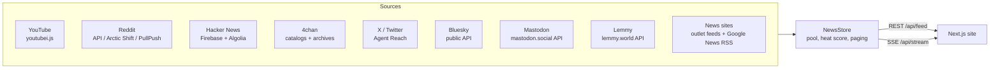

<div align="center">


### Everything the internet is posting, on every interest, in one live feed

YouTube · Reddit · Hacker News · 4chan · X / Twitter · Bluesky · Mastodon · Lemmy · news sites · Instagram · Facebook · TikTok, merged into one endless, self-updating page.

[](https://www.typescriptlang.org/)
[](https://nextjs.org/)
[](https://react.dev/)
[](https://tailwindcss.com/)
[](https://expressjs.com/)
[](https://vitest.dev/)

[Features](#features) · [Quick start](#quick-start) · [How it works](#how-it-works) · [Configuration](#configuration) · [Known limits](#known-limits)

<br />


</div>

---

## Features

- **Twelve sources, one feed.** Stories from YouTube, Reddit, Hacker News, every work-safe 4chan board, X / Twitter, Bluesky, Mastodon, Lemmy, thousands of news sites, Instagram, Facebook and TikTok, interleaved so no single platform takes over.
- **Every interest, not just news.** 18 interests (news, tech, AI, gaming, music, movies & TV, anime, sports, science, money, food, fitness, travel, cars, fun, learning, art, books) drive what each platform is read for. Each refresh reads the next interests in turn, so all of them stay current.
- **Live.** New Hacker News stories arrive through its official live stream within seconds. The server polls every other platform on its own timer (Bluesky every minute) and pushes changes to the browser over Server-Sent Events. New stories slide in at the top on their own, or behind an "↑ N new stories" button if you have scrolled down.
- **Endless scroll.** Every platform pages deeper as you scroll, back through its archive, so the feed and search do not run out.
- **Hot or Latest.** Hot ranks by how fast stories are being discussed; Latest shows the newest posts first, one platform at a time so a busy platform cannot bury the rest.
- **Fresh on every reload.** Each visit shuffles stories of similar heat, and stories you have already seen are hidden for 12 hours (stored in your browser only).
- **Shows what each platform has:**
  - videos play in the page (YouTube, TikTok, plus X and 4chan clips);
  - posts that link to an article show its preview image;
  - text-only posts show their own text.
- **Heat score.** Each story gets a 0–100 heat score from engagement per hour and its growth since the last refresh. The fastest risers get a **Rising** badge.
- **Search anything, including questions.** Searches every platform live and keeps paging as you scroll: "one piece" returns over 1,500 results across the first six pages, and "why is rice price rising" finds stories on six platforms. Question words are ignored; results must contain the topic's words, best matches come first, and when nothing has every keyword the search gives up generic words like "make" or "best" before topic words.
- **Fast.** The first search results show in about 1.5 s while slow platforms (X, Reddit) finish; the next page is prepared while you read. A full feed page never waits for a slow platform, and the server saves its stories to `server/.cache/pool.json` every 2 minutes, so a restart serves the feed at once.
- **Newest first, everywhere.** Hot and Latest work in the feed and in search. Searches open in Latest: results from every platform are merged newest to oldest across every page, so scrolling never jumps back to newer posts.

## Quick start

**Requirements:** Node.js 20+, Python 3.13 with [uv](https://docs.astral.sh/uv/), and git.

```bash
# 1. Node dependencies (server + web workspaces)
npm install

# 2. Python tool the server shells out to: yt-dlp (YouTube fallback)
uv venv --python 3.13 .venv
uv pip install --python .venv -e .

# 3. Agent Reach (X / Twitter, Facebook, Instagram, TikTok)
uv tool install https://github.com/Panniantong/Agent-Reach/releases/latest/download/agent-reach.zip
agent-reach setup && agent-reach add reddit && agent-reach add twitter
agent-reach add instagram && agent-reach add facebook

# 3b. One-time Instagram adapter patch (see Known limits)
opencli adapter eject instagram
cp docs/opencli/instagram-user.js ~/.opencli/clis/instagram/user.js

# 4. Run
npm run dev
```

Open **http://localhost:3000**. The API runs on http://127.0.0.1:4000.

> [!IMPORTANT]
> Install Agent Reach from the URL above, not from PyPI: the PyPI package named `agent-reach` is a different project.

### Optional: log in for X / Twitter and Instagram

X search needs your own logged-in session, and Instagram reads always do. Log in to the site in your browser, then copy the session to Agent Reach (or log in in the window it opens):

```bash
agent-reach browser profiles          # pick your browser profile
agent-reach login twitter --import-existing
agent-reach login instagram           # log in to instagram.com in the window that opens
```

TikTok and Facebook need no login for the feed; log in to Facebook (`agent-reach login facebook`) only if Facebook blocks your network.

### Scripts

| Command | What it does |
|---|---|
| `npm run dev` | Starts the API and the site with hot reload |
| `npm start` | Starts both without hot reload |
| `npm run build` | Builds the site for production |
| `npm test` | Runs the server tests (Vitest) |
| `npm run typecheck` | Type-checks the server and the site |

## How it works



The project has two parts:

| Folder | Stack | Role |
|---|---|---|
| [`server/`](server) | Express 5, TypeScript | Polls every platform, keeps a pool of up to 20,000 stories per platform, scores heat, and serves the feed, search and live stream |
| [`web/`](web) | Next.js 16, React 19, Tailwind CSS 4 | The page: the feed, filters, search, video players and endless scroll |

### Where the news comes from

| Platform | Feed (Hot and Latest) | Search | Refresh |
|---|---|---|---|
| Hacker News | Top, best and new stories (Firebase), new ones pushed live by HN's own stream, then every older story newest first (Algolia) | Every title match, then older date windows past Algolia's 1,000-hit limit | 1 min |
| 4chan | Every live thread on all ~50 work-safe boards (1 request per second, 4chan's API rule) | Live threads plus archived threads from the FoolFuuka archives (desuarchive, b4k, palanq), up to 5,000 per query | 3 min |
| Reddit | `hot` from Reddit across ~80 subreddits of all 18 interests (API keys or public JSON); when Reddit blocks the network, the same subreddits from the [Arctic Shift](https://arctic-shift.photon-reddit.com) archive, 3 interests per refresh, newest first | The query's own subreddits (Arctic Shift), matching posts from the subreddits that discuss it, and title matches across all of Reddit ([PullPush](https://pullpush.io)) | 2 min |
| YouTube | "Hot today" and "latest today" for every interest, 4 streams per refresh, continued page after page ([youtubei.js](https://github.com/LuanRT/YouTube.js); yt-dlp as fallback) | YouTube's own search, every page; Latest reads today's uploads, then this week, month and year (up to ~100 videos each, since YouTube cannot sort by date), then any time | 3 min |
| X / Twitter | Agent Reach search, one interest per refresh (needs login) | Agent Reach search | 5 min |
| Bluesky | Bluesky's "What's Hot" feed, page after page, plus the top posts of one interest per refresh (public API, no login); adult-labelled posts are dropped | Bluesky's own search: the 100 best posts (hot), or newest first page after page (latest) | 1 min |
| Mastodon | Trending posts across the fediverse, then each interest's hashtags, plus one interest per refresh (public API, no login); sensitive posts and content warnings are dropped | The query's hashtags ("one piece" -> #onepiece, #one, #piece), newest first, keeping posts with its words | 2 min |
| Lemmy | The Hot list of every community lemmy.world knows, page after page (public API, no login); NSFW posts and communities are dropped | Lemmy's own search, top of all time (hot) or newest first (latest) | 2 min |
| News sites | The outlets' own RSS / Atom feeds (41 feeds, e.g. BBC, NYT, The Verge, IGN, Variety, Space.com), with direct links, summaries and pictures: world news plus one interest per refresh; scrolling reads every interest's outlets, then Google News one week at a time going back | [Google News](https://news.google.com) RSS: the most relevant (or today's) articles, then one week at a time going back | 5 min |
| Instagram | One curated account per refresh (`opencli instagram user`, in the shared browser) | Only the collected pool (Instagram has no post search) | 5 min |
| Facebook | The browser searches the next interest each refresh, keeping post and video results | The browser's own search (~15-20 s per query) | 10 min |
| TikTok | The live trending page (`opencli tiktok explore`), then curated accounts via yt-dlp for deeper pages | Only the collected pool (TikTok's search API needs a login) | 3 min |

The interests, their subreddits and news outlets live in [`server/src/sources/interests.ts`](server/src/sources/interests.ts); refresh intervals in [`server/src/sources/index.ts`](server/src/sources/index.ts).

### API

| Endpoint | Returns |
|---|---|
| `GET /api/feed?platform=&offset=&limit=&seed=&sort=` | A page of the feed. `platform` is `all` or one platform; `limit` is at most 60; `sort` is `hot` or `latest` |
| `GET /api/search?q=&platform=&page=&sort=&fast=` | Search results, `hot` or `latest`, limited to 30 requests per minute per client. `fast=1` answers within about 1.5 s with what the quick platforms found (`partial: true`, slow ones in `pending`); ask again without it for the full page. The next page is built in the background |
| `GET /api/status` | Each platform's story count, last update and error |
| `GET /api/stream` | Server-Sent Events: `status` and `new` |

## Configuration

Set these as environment variables, or put them in `server/.env` (copy [`server/.env.example`](server/.env.example)). `.env` files are git-ignored.

| Variable | Default | Purpose |
|---|---|---|
| `PORT` / `HOST` | `4000` / `127.0.0.1` | Where the API listens |
| `WEB_ORIGIN` | `http://localhost:3000` | Allowed CORS origin |
| `NEXT_PUBLIC_API_URL` | `http://localhost:4000` | API address used by the site |
| `REDDIT_CLIENT_ID`, `REDDIT_CLIENT_SECRET` | unset | A Reddit "script" app for the official API (live `hot` list) |
| `YTDLP_BIN`, `AGENT_REACH_BIN`, `OPENCLI_BIN` | `.venv/bin/yt-dlp`, then `PATH`; `agent-reach` on `PATH`; Agent Reach's bundled `opencli` | Paths to the CLI tools |

## Known limits

- **Reddit** blocks many networks (VPNs, shared ISP addresses) with HTTP 403. The server then reads the Arctic Shift and PullPush archives. Arctic Shift scores are snapshots taken when a post is archived, so the newest posts show low points; PullPush is about six weeks behind.
- **X / Twitter** search needs you logged in to x.com in Agent Reach's own browser (`agent-reach login twitter`), and that login expires. When it is missing, X returns no results and Agent Reach reports "UPSTREAM_BROKEN: OpenCLI finished but returned no items", which looks like an outage but is a login problem.
- **News sites** in the feed come from the outlets' own feeds (listed per interest in [`interests.ts`](server/src/sources/interests.ts)); some outlets (the Guardian, ESPN) refuse automated readers and are left out. News search and the deep archive use Google News RSS: those cards show the headline, publisher and time but no image, and links open through news.google.com. Google limits quick bursts (HTTP 429), so requests are spaced 2 s apart and News pauses for 2 minutes after a 429.
- **Instagram** needs a login (`agent-reach login instagram`) before it shows anything: its public pages carry no post data. Even then it only reads curated accounts (no topic feed) and has no post search, so search only covers what the feed already collected. Its thumbnails and videos are signed CDN links that stop working within hours, so old cards fall back to their text.
- **Facebook** search works without a login but is slow (~15-20 s per query through a real browser), so it refreshes every 10 minutes. It cannot page: deeper search pages come from the collected pool. The feed keeps post and video results and drops page/profile/group hits.
- **TikTok** needs no login for the feed: live trending plus curated accounts read through yt-dlp. Its own search API needs a TikTok login, so search only covers the pool. Video covers are signed links that expire; photo posts show as image cards.
- **Quora and Threads** are not included. They block automated readers or need a logged-in account, and the only ways around that break their rules or need a paid API.
- **Mastodon** full-text search needs a login, so search reads hashtags: a post about the topic without a matching hashtag is not found.
- **Bluesky** videos are HLS streams, which browsers cannot play without a player library, so their cards show the thumbnail and open the post. Bluesky's search cursor needs a login, so deeper search pages ask for posts older than the last page instead.
- **4chan archives** cover 34 of the ~50 work-safe boards; the others (for example /tv/, /sp/, /lit/, /sci/) are searched in live threads only.
- **Shared services.** Arctic Shift, PullPush and the 4chan archives are run by volunteers; the server limits how often it calls them, and they sometimes answer slowly.
- **YouTube** results lean toward your IP's region and language.
- **Local only.** The API binds to 127.0.0.1 and has no authentication. Add authentication and rate limits before exposing it to the internet.

## Contributing

1. Fork the repository and create a branch.
2. Make your change and add tests for new logic in [`server/test/`](server/test).
3. Run `npm test` and `npm run typecheck`.
4. Open a pull request describing what changed and why.
