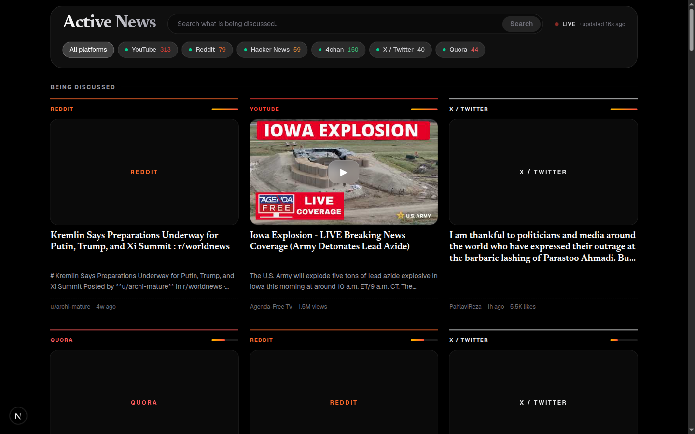
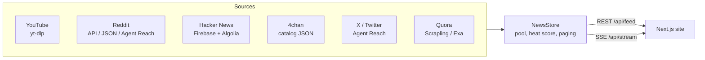

<div align="center">


### One live feed of what the internet is talking about, right now

YouTube · Reddit · Hacker News · 4chan · X / Twitter · Quora, merged into one endless, self-updating page.

[](https://www.typescriptlang.org/)
[](https://nextjs.org/)
[](https://react.dev/)
[](https://tailwindcss.com/)
[](https://expressjs.com/)
[](https://vitest.dev/)

[Features](#features) · [Quick start](#quick-start) · [How it works](#how-it-works) · [Configuration](#configuration) · [Known limits](#known-limits)

<br />



</div>

---

## Features

- **Six platforms, one feed.** Stories from YouTube, Reddit, Hacker News, 4chan /news/, X / Twitter and Quora, interleaved so no single platform takes over.
- **Live.** The server polls each platform on its own timer and pushes changes to the browser over Server-Sent Events. New stories slide in at the top on their own, or behind an "↑ N new stories" button if you have scrolled down.
- **Endless scroll.** Every platform pages deeper as you scroll. Sources without real paging (X, Quora, the Reddit fallback) rotate through news topics, so the feed does not run out.
- **Fresh on every reload.** Each visit shuffles stories of similar heat, and stories you have already seen are hidden for 12 hours (stored in your browser only).
- **Shows what each platform has:**
  - videos play in the page (YouTube, plus X and 4chan clips);
  - posts that link to an article show its preview image;
  - text-only posts show their own text.
- **Heat score.** Each story gets a 0–100 heat score from engagement per hour and its growth since the last refresh. The fastest risers get a **Rising** badge.
- **Search.** Searches the stories already collected, plus live search on Hacker News, YouTube, Reddit and X.

## Quick start

**Requirements:** Node.js 20+, Python 3.13 with [uv](https://docs.astral.sh/uv/), and git.

```bash
# 1. Node dependencies (server + web workspaces)
npm install

# 2. Python tools the server shells out to: yt-dlp (YouTube) and Scrapling (Quora)
uv venv --python 3.13 .venv
uv pip install --python .venv -e .
.venv/bin/scrapling install

# 3. Agent Reach (Reddit fallback, X / Twitter, web search)
uv tool install https://github.com/Panniantong/Agent-Reach/releases/latest/download/agent-reach.zip
agent-reach setup && agent-reach add reddit && agent-reach add twitter

# 4. Run
npm run dev
```

Open **http://localhost:3000**. The API runs on http://127.0.0.1:4000.

> [!IMPORTANT]
> Install Agent Reach from the URL above, not from PyPI: the PyPI package named `agent-reach` is a different project.

### Optional: log in for X / Twitter

X search needs your own logged-in session. Log in to x.com in your browser, then copy the session to Agent Reach:

```bash
agent-reach browser profiles          # pick your browser profile
agent-reach login twitter --import-existing
```

### Scripts

| Command | What it does |
|---|---|
| `npm run dev` | Starts the API and the site with hot reload |
| `npm start` | Starts both without hot reload |
| `npm run build` | Builds the site for production |
| `npm test` | Runs the server tests (Vitest) |
| `npm run typecheck` | Type-checks the server and the site |

## How it works



The project has three parts:

| Folder | Stack | Role |
|---|---|---|
| [`server/`](server) | Express 5, TypeScript | Polls every platform, keeps a pool of up to 1,500 stories per platform, scores heat, and serves the feed, search and live stream |
| [`web/`](web) | Next.js 16, React 19, Tailwind CSS 4 | The page: the feed, filters, search, video players and endless scroll |
| [`scripts/quora.py`](scripts/quora.py) | Python, Scrapling | Quora scraper; Scrapling is Python-only, so the server runs this script |

### Where the news comes from

| Platform | Source | Refresh |
|---|---|---|
| Hacker News | Official top, best and new stories (Firebase API) | 2 min |
| 4chan /news/ | Catalog in bump order | 2 min |
| YouTube | News uploaded today, by views, across 8 rotating searches (yt-dlp) | 5 min |
| X / Twitter | Agent Reach search across 12 rotating news topics (needs login) | 5 min |
| Reddit | `hot` across 10 news subreddits: official API, then public JSON, then Agent Reach search | 10 min |
| Quora | World News topic (Scrapling), then Exa web search | 30 min |

Queries, subreddits, topics and refresh intervals live at the top of each file in [`server/src/sources/`](server/src/sources).

### API

| Endpoint | Returns |
|---|---|
| `GET /api/feed?platform=&offset=&limit=&seed=` | A page of the feed. `platform` is `all` or one platform; `limit` is at most 60 |
| `GET /api/search?q=&platform=&page=` | Search results, limited to 30 requests per minute per client |
| `GET /api/status` | Each platform's story count, last update and error |
| `GET /api/stream` | Server-Sent Events: `status` and `new` |

## Configuration

Set these as environment variables, or put them in `server/.env` (copy [`server/.env.example`](server/.env.example)). `.env` files are git-ignored.

| Variable | Default | Purpose |
|---|---|---|
| `PORT` / `HOST` | `4000` / `127.0.0.1` | Where the API listens |
| `WEB_ORIGIN` | `http://localhost:3000` | Allowed CORS origin |
| `NEXT_PUBLIC_API_URL` | `http://localhost:4000` | API address used by the site |
| `REDDIT_CLIENT_ID`, `REDDIT_CLIENT_SECRET` | unset | A Reddit "script" app for the official API (live `hot` list) |
| `EXA_API_KEY` | unset | Your own [Exa](https://exa.ai) key for Quora, instead of Agent Reach's shared, rate-limited search |
| `YTDLP_BIN`, `PYTHON_BIN`, `AGENT_REACH_BIN` | `.venv/bin/*`, then `PATH` | Paths to the CLI tools |

## Known limits

- **Reddit** blocks many networks (VPNs, shared ISP addresses) with HTTP 403. Without API keys, the server falls back to search results, which can be days old.
- **X / Twitter** needs a logged-in session imported into Agent Reach, and that session expires.
- **Quora** usually blocks automated browsers, so it mostly comes from web search.
- **YouTube** results lean toward your IP's region and language.
- **Local only.** The API binds to 127.0.0.1 and has no authentication. Add authentication and rate limits before exposing it to the internet.

## Contributing

1. Fork the repository and create a branch.
2. Make your change and add tests for new logic in [`server/test/`](server/test).
3. Run `npm test` and `npm run typecheck`.
4. Open a pull request describing what changed and why.
